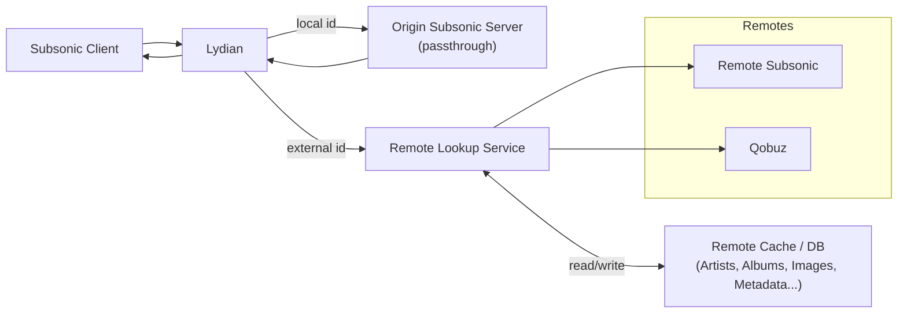

<h1  align="center">
Lydian
</h1>

---

Lydian is a simple, fast and lightweight proxy server for Subsonic written in Rust.
It allows you to trasparently integrate multiple providers (Navidrome, Qobuz...) into a single Subsonic API, making it easy to expand your music library without changing your existing setup.

> [!WARNING]
> This project is still in early development, and is not yet ready for production use. 
> Also, it is mainly for personal use, so it may not be as polished. 
> If you want to use it, please be aware of the risks and limitations.

## Architecture

Lydian stays in between the Subsonic client and the origin Subsonic server.
It intercepts the requests from the client, and forwards them to the origin server.
Some routes are intercepted and handled by Lydian itself, where based on some parameters,
it will perform a lookup on the remote providers, and return the results to the client.

IDs in Lydian are in the `{provider}___{type}___{id}` format, where:
* `{provider}` is the provider name from config (must be unique!!)
* `{type}` is the type of the resource (artist, album, song, playlist, etc...)
* `{id}` is the original ID of the resource from the provider.

## Differences with Octo-Fiesta

Lydian mainly does the same thing as Octo-Fiesta, but taking a different approach in mind on how to implement it.

Diffrences include:
* Lydian supports configuring multiple providers of the same type, while Octo-Fiesta only defaults to the configured one.
* Lydian supports streaming from other Open Subsonic servers, allowing for a "federated" experience.
* Octo-Fiesta currently supports a wider range of providers, while Lydian is currently limited to Navidrome and Qobuz. However, Lydian is designed to be easily extensible, allowing for the addition of new providers in the future.
* Lydian streams music directly in real time, offering a more seamless experience, while Octo-Fiesta (mainly for Tidal instances) takes long before the music starts playing (at least from my experience), as it needs to download the entire file first before streaming it.
* Octo-Fiesta has a better collision handling system, while Lydian currently has a basic one. This is subject to change.
* Lydian *requires* an admin account connected to the origin server.
* Lydian *heavily* relies on caching to improve performance, and to not spam remotes,
* Lydian performs multiple API calls in parallel and merges the results (allowing to fetch from multiple sources), while Octo-Fiesta only fetches from one source at a time.
* Octo-Fiesta supports lyrics fetching, while Lydian does not (yet).
* Octo-Fiesta is more mature and has been around for longer, and has been tested against more clients and servers.
* Lydian supports "multi libraries", so that each user gets its own folder when downloading music.
* Octo-Fiesta has a test suite, Lydian still lacks one.
* Octo-Fiesta supports playlists.

## Contributing

This project doesn't have a clear roadmap yet, and is mainly for personal use.
Furthermore, the project is not hosted on GitHub.

That said, if you want to contribute, feel free to open an issue or a pull request, and I'll try
to handle it somehow :P.

## Acknowledgements

* [Navidrome](https://www.navidrome.org/) for being a great open source Subsonic server and what I use.
* [Octo-Fiesta](https://github.com/V1ck3s/octo-fiesta) for being a great inspiration and reference for this project.
* [Open Subsonic Documentation](https://opensubsonic.netlify.app/docs/) for making it easier to understand how the API works.
* [Squidify (SquidWTF)](https://www.squidify.org/) for unknowingly providing the third party navidrome server to test against, and the great collection :).

## License

Lydian is licensed under the GPL-3.0 License. See [LICENSE](LICENSE) file for more information.
